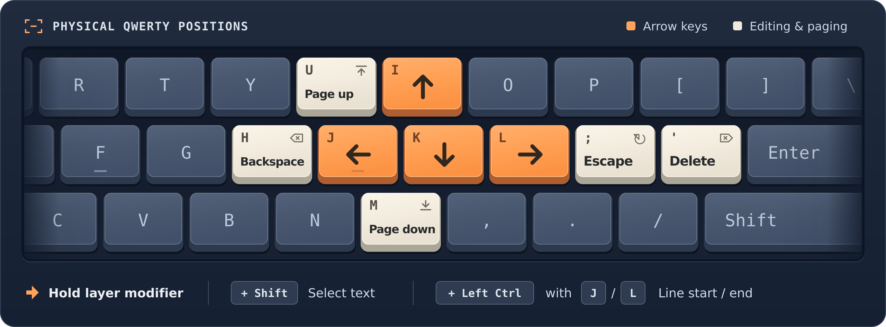

# Diamond Cursor

<a href="https://cray0000.github.io/diamond-cursor/#key-map"></a>

Move and select text without reaching for the arrow keys. Hold the modifier with your left thumb and use the **I/J/K/L** diamond with your right hand. The mappings work across applications and follow physical US QWERTY key positions, so the diamond stays under the same fingers when you switch to Dvorak, Russian, or another layout.

[Try the interactive key map and setup guides](https://cray0000.github.io/diamond-cursor/)

## Mappings

Hold **Left Alt** on Linux. On macOS, hold **Left Option** on a standard keyboard or **Left Command** on the Apple laptop keyboards remapped by the Universal profile.

| While holding the modifier, press | Result |
| --- | --- |
| I | ↑ Up |
| J | ← Left |
| K | ↓ Down |
| L | → Right |
| U / M | Page Up / Page Down |
| H / apostrophe (`'`) | Backspace / Forward Delete |
| Semicolon (`;`) | Escape |
| Left Ctrl + J / L | Home / End on Linux, ⌘← / ⌘→ on macOS |

Add **either Shift** to send the shifted version of any mapped key. For example, hold the modifier and Shift, then tap **L** to select one character to the right. Add **Left Ctrl** to select to the end of the line in a typical text editor.

## Quick install

Clone the repository once, then follow the steps for your operating system.

```sh
git clone https://github.com/cray0000/diamond-cursor.git
cd diamond-cursor
```

### Ubuntu

Run the installer from the repository root.

```sh
./linux/install.sh
```

The script sets up `keyd` and enables the mapping at boot. It also includes a touchpad pairing rule so laptops can keep suppressing accidental touches while you type. For other Linux distributions, existing configurations, and uninstall instructions, see the [Linux guide](linux/README.md).

### macOS

Install Karabiner-Elements and follow its permission prompts. If you already use Karabiner, back up your profiles first. The supplied JSON replaces the entire configuration. [Karabiner setup](https://karabiner-elements.pqrs.org/docs/getting-started/installation/)

Copy the configuration from the repository root.

```sh
mkdir -p ~/.config/karabiner
cp -i macos/karabiner.json ~/.config/karabiner/karabiner.json
```

Open **Karabiner-Elements Settings → Profiles** and select **Universal**. Hold the key directly left of the space bar and tap **J** to move left. With default macOS settings, use **⌘ Command** on the two MacBook keyboards Universal recognizes, or **Alt (Option)** on a PC-style external keyboard. [Set up another keyboard](macos/README.md#set-up-another-keyboard)

## License

MIT
